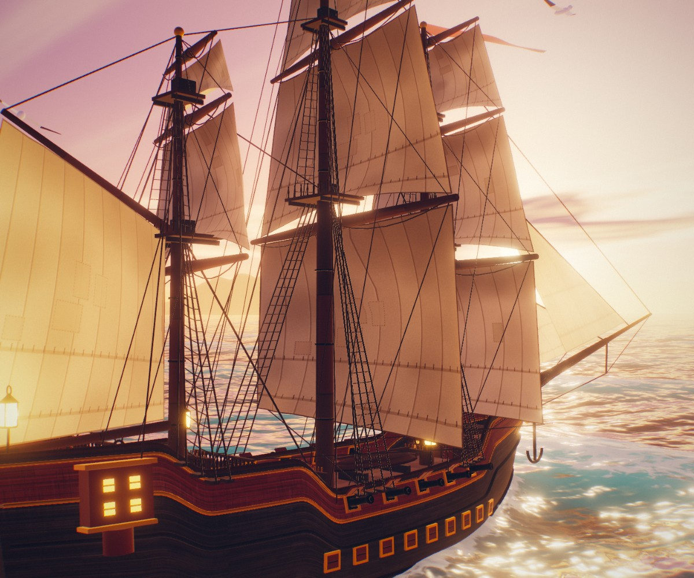
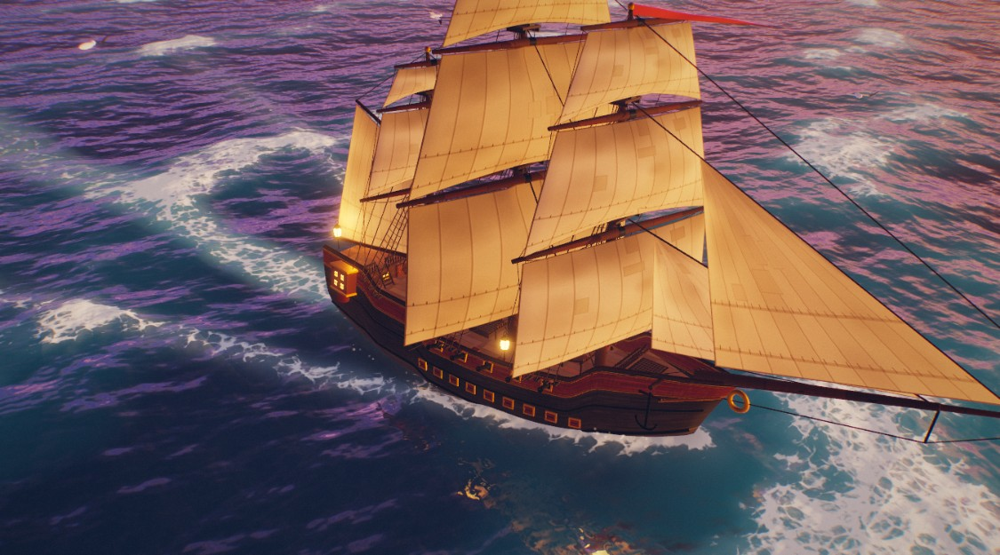
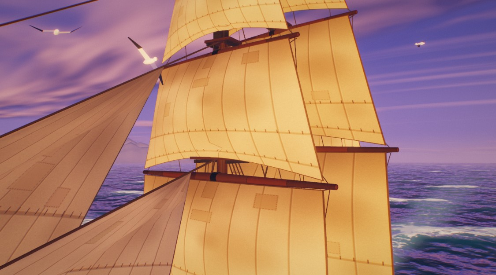
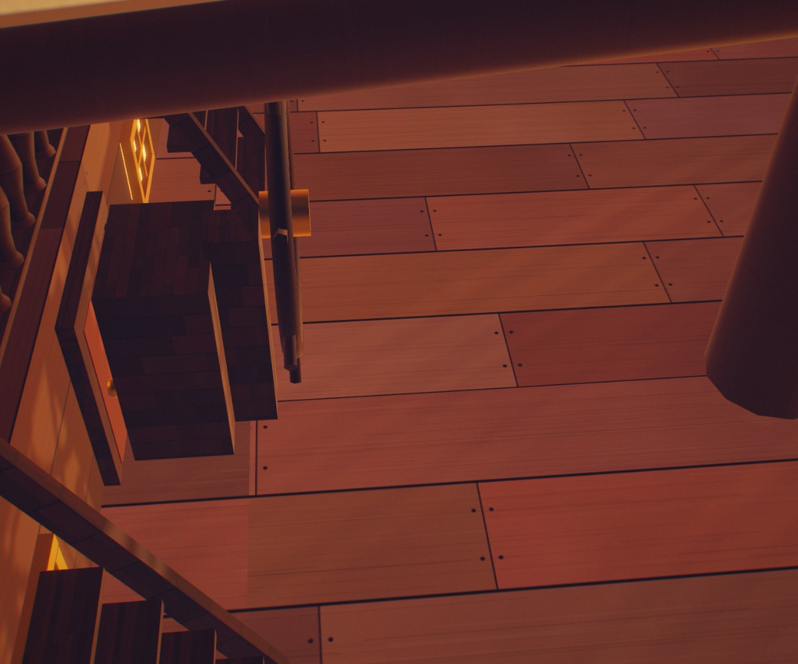
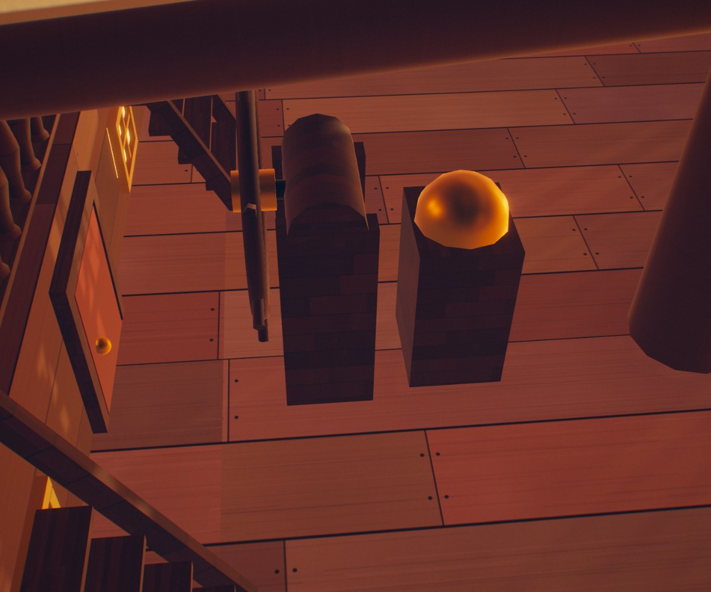

# 🏴‍☠️ navio-3d — um galeão num oceano vivo, feito só com código



Um galeão pirata de três mastros navegando ao pôr do sol, em **Three.js**, num **único `index.html`**
(644 KiB, já com o Three.js dentro). Nenhum modelo 3D nem textura baixados: casco, velas, cordame,
madeira, lona e bandeira nascem do código.

**Abrir:** baixe o repositório e dê dois cliques em `index.html`. Funciona direto do disco, sem
servidor. Arraste para girar e use a roda do mouse para aproximar. Parado, a câmera filma sozinha.

## Por que este repositório existe

Foi um **desafio de aprendizado**: aprender Three.js de verdade e fazer um modelo 3D de muita
qualidade sem baixar nada. O ponto de partida foi a cena "Pirate Ship at Sunset", que um modelo
do Claude gerou a partir de um prompt e o @vib3coded mostrou num reel. Ela serviu de **referência
para estudar**, não de fonte: nada do arquivo dela foi copiado. A arquitetura foi entendida e
reescrita aqui em código próprio, legível e comentado em português, e cada sistema foi comparado
lado a lado com a referência.

Quer tentar também? O prompt do desafio está em **[PROMPT.md](PROMPT.md)** (português e inglês).

## O que tem dentro

| Sistema | Como foi feito |
|---|---|
| Oceano | malha radial mais densa no centro, **7 ondas de Gerstner** no vértice; o navio fica parado e o mar corre a 7,5 m/s; onda de proa, rastro, espuma nas cristas, reflexo planar do navio e sombra calculada no shader |
| Flutuação | a mesma soma de ondas no processador (3 iterações, porque a crista anda de lado) dá altura, arfagem e jogo, filtrados por molas amortecidas |
| Céu | shader próprio: gradiente atmosférico, brilho do sol, nuvens por ruído; reflexo por `CubeCamera` |
| Casco | funções de meia-boca, fundo e tosamento → malha de 120 × 68; peças juntadas por material |
| Velas | o vértice é empurrado pela barriga (seno, rajada, tremor) e a normal é refeita no shader; **a lona cede onde um estai passa na frente** |
| Cordame | ~890 cabos numa única `InstancedMesh`; gaivotas em 5 `InstancedMesh` |
| Câmera | órbita própria com senos que não se repetem; recua sozinha se for chegar perto de vela ou cabo |
| Pós | brilho, borrão em 5 níveis, aberração cromática, clarão do sol, ACES, curva, vinheta e grão |
| Desempenho | resolução adaptativa; sombra e reflexo se revezam de quadro em quadro |

| | |
|---|---|
|  |  |

## O leme que estava de costas

A primeira versão montou a bússola **atrás** da roda do leme: o capitão teria que dirigir olhando
para trás. Quem achou foi um humano olhando a cena, não um teste. O conserto nasceu junto com um
teste que reprova a versão errada (`testes/teste_leme.py`).

| Antes (bússola atrás da roda) | Depois (bússola à frente; a proa fica à direita) |
|---|---|
|  |  |

Depois disso, um avaliador cego (um agente que só vê a peça e a régua) deu **35/100** e achou dez
defeitos que os testes não viam: cabos atravessando velas, bujarronas se cruzando, bandeira voando
contra o vento das velas, lanterna plantada em cima de um canhão, câmera entrando na vela. Cada
um virou um teste sobre a **geometria real**, com a barriga das velas calculada como no shader.
Uma segunda avaliação cega ainda não terminou.

## Construir e testar

```bash
npm ci
node build.mjs
```

O build junta `src/` (com o Three.js) num `index.html` e mede o próprio peso. Código nosso
minificado, sem o Three: 75,4 KiB.

Os testes usam Python com Playwright e um servidor local na porta 8732 (por exemplo,
`python -m http.server 8732`):

| Teste | O que prova | Hoje |
|---|---|---|
| `testes/bateria.py` | console limpo, nada parado por mais de 0,5 s, constantes do `CONFIG` mudando a cena, silhueta sem pós-processamento, zero modelo 3D, aviso sem WebGL, movimento reduzido, bandeira e flâmula visíveis em 3 poses, peso | 15/15 |
| `testes/teste_geometria.py` | nenhum cabo atravessa vela, nenhuma vela atravessa outra, um só vento, aves instanciadas, câmera fora das velas em 576 poses | 8/8 |
| `testes/teste_conves.py` | leme na orientação certa; nenhuma peça do convés dentro ou em cima de outra (caixas medidas da geometria) | passa |
| `testes/orcamento.py` | chamadas de desenho e triângulos por quadro no pior caso | 90 e 265 mil |
| `testes/medir.py` | FPS num navegador sem janela, com a placa escolhida | 56 a 60 FPS numa Intel UHD a 1280×720 |

Cada teste traz um caso doente (que tem de reprovar) ao lado do controle são. `medir.py` e
`comparar.py` comparam com a cena de referência, que **não** está neste repositório: eles esperam
uma cópia dela num servidor na porta 8731.

## Licenças

Código deste repositório: **MIT**, © 2026 Vitor (ROONDOW) — veja [LICENSE](LICENSE). Pode usar,
modificar e redistribuir, desde que mantenha o aviso de copyright e a licença.

O Three.js também é MIT; o aviso dele fica no fim do `index.html` e em
[LICENCAS/three.js-MIT.txt](LICENCAS/three.js-MIT.txt).
